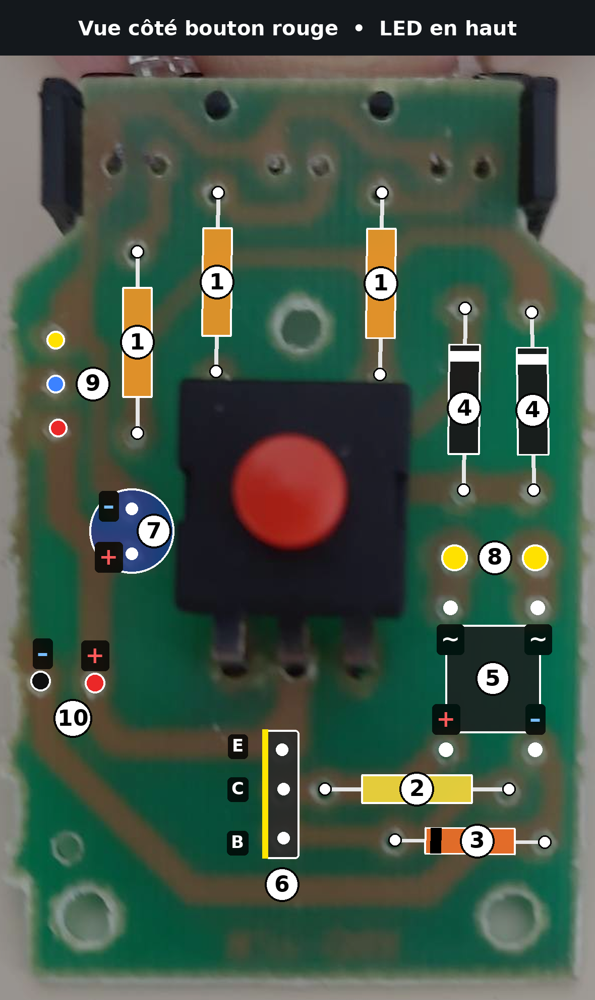

# Lampe dynamo — carte WJY-04A en 3D

Plan de montage d'un kit de lampe de poche à manivelle (3 LED, batterie Ni-MH 3,6 V).
Le kit était livré sans notice : l'emplacement de chaque composant a été reconstitué
en suivant les pistes de la carte sur photo.

**Voir la maquette 3D en ligne : https://sacha9214.github.io/lampe-dynamo-3d/**

- `index.html` — maquette 3D de la carte, à faire tourner à la souris ou au doigt.
  Vues dessus / soudures / éclatée, et une étape par composant.
- `plan-implantation.png` — le même plan à plat, vu côté bouton.

## Ordre de soudure

Du plus bas au plus haut, la batterie en dernier.

| N° | Composant | Sens |
|---:|---|---|
| 1 | 3 résistances 200 Ω | indifférent |
| 2 | Résistance 160 Ω | indifférent |
| 3 | Diode en verre orange | anneau noir côté transistor |
| 4 | 2 diodes noires | anneau côté LED |
| 5 | Pont DB107 | les deux « ~ » côté fils moteur, « + » vers le centre, « − » vers le bord |
| 6 | Transistor D882 | inscription tournée vers le côté batterie |
| 7 | Condensateur 100 µF 16 V | bande « − » côté LED |
| 8 | 2 fils du moteur | indifférent |
| 9 | 3 fils de la prise DC | rouge : tige centrale, bleu : contact extérieur, jaune : troisième patte |
| 10 | Batterie | rouge (+) vers l'intérieur, noir (−) au bord |

## Avant de souder la batterie

Tourner la manivelle et appuyer sur le bouton : 1 LED sur une position, 3 LED sur l'autre.
Si rien ne s'allume, ne pas souder la batterie.

## Limites

Ce plan n'est pas tiré d'une notice. Les pattes de la prise DC sont le point le moins sûr :
les vérifier au multimètre avant de câbler.
